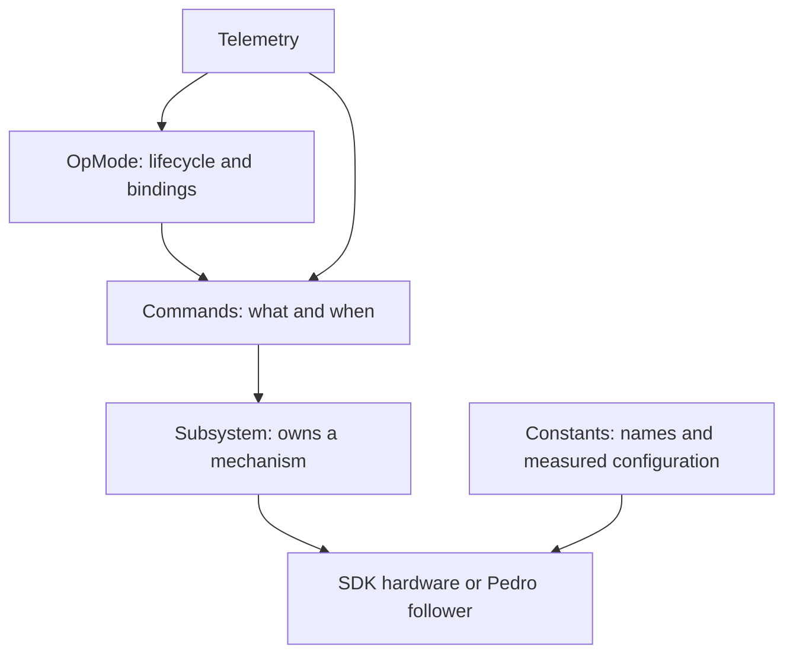

# 02 - Project structure and responsibilities

[עברית](he/02-structure.md)

[Guide index](../../README.md#learning-path) | Next: [Java and FTC foundations](03-foundations.md)

## The build is a root application

This project uses Dairy's FTC plugin rather than the traditional pair of Gradle modules. The root application explicitly points to `TeamCode/src/main`. The folder name TeamCode does not make it a separate Gradle project. Open the repository root and use its Android app configuration with **Run ▶** to build and install. For occasional checks in the Gradle tool window, use tasks under the root project.

```text
repository/
  README.md, CHANGELOG.md, LICENSE
  build.gradle.kts, settings.gradle.kts, gradle.properties
  gradlew, gradlew.bat, gradle/wrapper/
  libs/ftc.debug.keystore
  TeamCode/src/
    main/AndroidManifest.xml
    main/java/org/firstinspires/ftc/teamcode/
      RobotCommandOpMode.java
      opmodes/StarterTeleOp.java
      examples/Example01...Example07...
      subsystems/MotorCommands.java, MotorSubsystem.java, ServoSubsystem.java
      subsystems/drivetrain/PedroDrive.java
      pedroPathing/Constants.java, Tuning.java
    main/res/
  doc/guide/, doc/archive/
  FtcRobotController/       upstream references, not a compiled module
  build/, .gradle/         generated output and caches
```

## What each root file does

| File or directory | Responsibility | When you change it |
|---|---|---|
| `build.gradle.kts` | Plugins, dependencies, Android source sets | Adding/reviewing a library or changing source layout |
| `settings.gradle.kts` | Plugin repositories, toolchain resolver, project name | Renaming the project or intentional build restructuring |
| `gradle.properties` | Android flags, JVM memory, caches, standalone lint version | Diagnosing build resource or tooling behavior |
| `gradle/wrapper/` and wrapper scripts | Reproducible Gradle distribution | A coordinated tooling upgrade |
| `local.properties` | This machine's Android SDK location | Local setup only; never commit |
| `libs/ftc.debug.keystore` | Shared FTC development signing identity | Preserve for development; it is not a private production signing secret |
| `.github/` | Team review/contribution guidance | Team workflow changes |
| `.gitignore` | Excludes build output, caches, IDE/local settings | Adding another generated/local directory |

`gradle.properties` pins a newer standalone lint because older bundled lint cannot fully read the Kotlin metadata used by these libraries. That does not upgrade the Android Gradle plugin. The removed module-local scripts are not needed.

## Java layers



An OpMode decides which controls and routines to use. A command describes an action and its lifetime. A subsystem is the one owner of a mechanism and exposes operations/command factories. Constants describe this particular robot. Avoid putting another direct `setPower()` for the same motor into an unrelated OpMode; that bypasses command ownership.

`RobotCommandOpMode` is reusable lifecycle infrastructure. `MotorCommands` implements cleanup shared by continuous actions. `MotorSubsystem` and `ServoSubsystem` are generic examples you can copy/rename. `PedroDrive` owns the follower and updates it once through `periodic()`. `Constants` builds the drivetrain, localizer and algorithm. Team routines belong in `opmodes`; numbered lessons stay in `examples`.

## Resources, SDK references and history

The minimal manifest merges with SDK/library manifests. `res/values` contains Android resources; webcam calibration XML is an SDK-facing resource, not Pinpoint calibration. Keep resources that you actually use and retain upstream notices. `FtcRobotController` contains upstream sample sources but is excluded from this build; copy/adapt a sample into TeamCode if you want it compiled. Do not edit SDK internals to add a mechanism.

The pre-template robot are in [the archive](../archive/pre-template/INDEX.md). They keep their original packages but are outside the configured source sets, so they do not enter the APK or conflict with active classes. Historical upgrade reports describe that earlier robot, not today's generic configuration.

Exercise: trace the default drive command from StarterTeleOp through PedroDrive into the follower. Then find the single active `follower.update()` site used by that subsystem. This is the path you should understand before adding autonomous.
