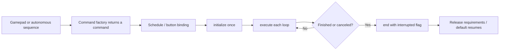

# 04 - Commands, subsystems and scheduling

[עברית](he/04-commands.md)

[Guide index](../../README.md#learning-path) | Example: [04 Command groups](../../TeamCode/src/main/java/org/firstinspires/ftc/teamcode/examples/Example04CommandGroups.java) | Next: [hardware](05-hardware.md)

## What runs each loop

The command scheduler coordinates actions without a blocking script. `super.run()` services registered subsystems, buttons, and scheduled commands. A subsystem's `periodic()` is called automatically; PedroDrive uses it to update localization and motor outputs. Default commands are scheduled when a subsystem is free, so their first execution may be on a later scheduler iteration. Do not depend on one exact loop count for physical timing.

Calling `motor.run(() -> 0.2)` only constructs a command. It does not power a motor. Schedule the result, bind it to a button, or place it in a scheduled group. The archived robot had a loop that created a load command and discarded it; this is why the distinction matters.

## Lifecycle and cleanup

| Operation | Use |
|---|---|
| `initialize()` | Establish state once when starting |
| `execute()` | Apply/update the action each scheduler cycle |
| `isFinished()` | Say when normal completion occurs |
| `end(interrupted)` | Release outputs after completion or cancellation |

An `InstantCommand` runs once and finishes. A `RunCommand` repeats and does not finish by itself. `MotorCommands.run(action, stop, finished, requirements...)` builds a continuous command that checks its finish condition and invokes cleanup on termination. A default stop command must keep running; an explicit stop inside a sequence must finish. Mixing these up can leave a sequence stuck forever.

Cancellation invokes cleanup; it is not the same as calling `stopCommand()` on another subsystem. Code placed after an interrupted command in `.andThen(...)` is not guaranteed to run. Put mandatory motor cleanup in `end`, as MotorCommands does. RobotCommandOpMode cancels commands before discarding the scheduler, so their cleanup is not lost.

## Requirements and ownership

Pass the subsystem as a requirement whenever a command controls it. The scheduler prevents two independent commands from owning the same subsystem at the same time. Scheduling a competing interruptible command cancels the current owner. A group owns the union of its children's requirements, potentially for the entire group lifetime.

The motor lesson binds A and B to opposite commands on the same subsystem. Those are mutually competing actions, not two independent powers to combine. Avoid holding both. Parallel children must not require the same subsystem; put shared-mechanism actions in sequence instead.

Pedro's FollowPathCommand knows its follower, but not our PedroDrive wrapper. Example06 explicitly adds `drive` as a requirement to its parent sequence. Follow that pattern when combining path commands and a drivetrain default command. A mechanism action inside the same routine should be a group child, not independently scheduled from a callback that steals the parent's requirements.

## Buttons and suppliers

- `whenPressed(command)` starts on a press edge; release does not necessarily cancel it.
- `whileHeld(command)` runs while held and cancels on release. It can reschedule an already finished command while the button remains held; consider this if handling faults.
- `toggleWhenPressed(command)` toggles a continuous command on/off.
- Runnable bindings are convenient for instant changes such as toggling a boolean.

Create a fresh command from a factory for each distinct group/binding composition. Do not put one command instance into multiple groups. Values captured as primitives are snapshots; suppliers can read live values. Read the specific factory to see whether it evaluates once or every loop.

## Groups and time

| Composition | Finishes when | Appropriate example |
|---|---|---|
| `SequentialCommandGroup` | Each child finishes in order | Move servo, wait, run motor |
| `ParallelCommandGroup` | All children finish | Independent finite actions |
| `ParallelDeadlineGroup` | The designated first child finishes | Run motor until a timer or path completes |
| `.withTimeout(750)` | Command finishes or 750 ms expires | Bound an open-loop motor action |
| `WaitCommand(250)` | 250 ms expires | Non-blocking delay between actions |

This library's durations here are **milliseconds**. A servo request finishing means the request was sent; a chosen wait is only an estimate of travel time. A timeout ending a path means time elapsed, not that the destination was reached. Add explicit telemetry or a fault decision if later scoring depends on arrival.

Avoid `sleep()` or a long `while` inside `execute()`/`run()`: they prevent scheduler updates, localization, button processing, and telemetry. Model waiting as a command or a condition checked each cycle.

Exercise: shorten the motor deadline in Example04, confirm the servo action and cleanup still occur, then cancel halfway with B. Next add a second *different* subsystem in parallel. Explain which group owns each subsystem before running it.
