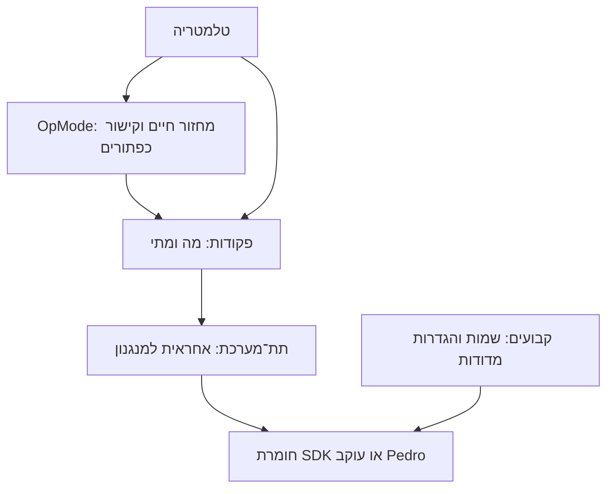

<div dir="rtl" lang="he">

# 02 - מבנה הפרויקט ותחומי אחריות

[English](../02-structure.md) | [תוכן המדריך](../../../README.he.md#learning-path) | הבא: [יסודות Java ו־FTC](03-foundations.md)

## הבנייה היא יישום בשורש הפרויקט

הפרויקט משתמש בתוסף FTC של Dairy במקום בזוג מודולי Gradle המסורתי. יישום השורש מפנה במפורש אל `TeamCode/src/main`. שם התיקייה TeamCode אינו הופך אותה לפרויקט Gradle נפרד. פתחו את שורש המאגר והשתמשו בתצורת יישום Android וב־**Run ▶** לבנייה ולהתקנה. לבדיקות מזדמנות בחלון Gradle השתמשו במשימות של פרויקט השורש.

<div dir="ltr">

```text
repository/
  README.md, CHANGELOG.md, LICENSE
  build.gradle.kts, settings.gradle.kts, gradle.properties
  gradlew, gradlew.bat, gradle/wrapper/
  libs/ftc.debug.keystore
  TeamCode/src/
    main/AndroidManifest.xml
    main/java/org/firstinspires/ftc/teamcode/
      RobotCommandOpMode.java
      opmodes/StarterTeleOp.java
      examples/Example01...Example07...
      subsystems/MotorCommands.java, MotorSubsystem.java, ServoSubsystem.java
      subsystems/drivetrain/PedroDrive.java
      pedroPathing/Constants.java, Tuning.java
      pedroPathing/procedures/
    main/res/
  doc/guide/, doc/archive/
  FtcRobotController/
  build/, .gradle/
```

</div>

`FtcRobotController` מכיל מקורות לעיון מהמאגר המקורי ואינו מודול מקומפל. `build/` ו־`.gradle/` מכילים פלט שנוצר ומטמונים.

## תפקיד קובצי השורש

| קובץ או תיקייה | אחריות | מתי משנים |
|---|---|---|
| `build.gradle.kts` | תוספים, תלויות וקבוצות מקורות Android | הוספה או בדיקה של ספרייה, או שינוי מבנה המקורות |
| `settings.gradle.kts` | מאגרי תוספים, פותר שרשראות כלים ושם הפרויקט | שינוי שם הפרויקט או ארגון מכוון של הבנייה |
| `gradle.properties` | דגלי Android, זיכרון JVM, מטמונים וגרסת lint עצמאית | אבחון משאבי בנייה או התנהגות כלים |
| `gradle/wrapper/` וסקריפטי wrapper | הפצת Gradle ניתנת לשחזור | שדרוג מתואם של כלי הפיתוח |
| `local.properties` | מיקום Android SDK במחשב זה | הגדרה מקומית בלבד; לעולם לא לבצע commit |
| `libs/ftc.debug.keystore` | זהות חתימה משותפת לפיתוח FTC | לשמר לפיתוח; אינה סוד חתימה פרטי לייצור |
| `.github/` | הנחיות סקירה ותרומה לקבוצה | שינוי תהליך העבודה הקבוצתי |
| `.gitignore` | החרגת פלט בנייה, מטמונים והגדרות IDE ומחשב | הוספת תיקייה מקומית או שנוצרת אוטומטית |

`gradle.properties` מקבע גרסת lint עצמאית חדשה יותר, משום שהגרסה הישנה המצורפת אינה קוראת במלואה את מטא־הנתונים של Kotlin בספריות אלה. הדבר אינו משדרג את Android Gradle plugin. אין צורך בסקריפטים המקומיים של המודולים שהוסרו.

## שכבות Java

<div dir="ltr">



</div>

OpMode בוחר בקרות ושגרות. פקודה מתארת פעולה ואת משך חייה. תת־מערכת היא האחראית היחידה למנגנון וחושפת פעולות ומפעלי פקודות. הקבועים מתארים את הרובוט המסוים. הימנעו מקריאת `setPower()` ישירה נוספת לאותו מנוע ב־OpMode לא קשור; היא עוקפת את הבעלות של הפקודות.

`RobotCommandOpMode` מספק תשתית מחזור חיים לשימוש חוזר. `MotorCommands` מממש ניקוי המשותף לפעולות רציפות. `MotorSubsystem` ו־`ServoSubsystem` הן דוגמאות כלליות להעתקה ושינוי שם. `PedroDrive` אחראי לעוקב ומעדכן אותו פעם אחת דרך `periodic()`. `Constants` מחזיק את `drivetrainConfig`,‏ `localizerConfig` ו־`foresightConfig` ומספק מפעלים לרכיבים שלהם. `Tuning` רושם את ארבעת הליכי AutoTune בדפדפן מתוך `pedroPathing/procedures`; הוא אינו OpMode. שגרות הקבוצה שייכות ל־`opmodes`; השיעורים הממוספרים נשארים ב־`examples`.

## משאבים, מקורות SDK והיסטוריה

המניפסט המינימלי מתמזג עם מניפסטים של SDK וספריות. `res/values` מכיל משאבי Android; קובץ XML לכיול מצלמת רשת הוא משאב עבור ה־SDK, ואינו כיול Pinpoint. שמרו משאבים שבשימוש והודעות זכויות מקוריות. `FtcRobotController` מכיל דוגמאות מקוריות אך מוחרג מהבנייה; העתיקו והתאימו דוגמה ל־TeamCode כדי לקמפל אותה. אין לערוך את פנים ה־SDK כדי להוסיף מנגנון.

קוד הרובוט מלפני התבנית נמצא ב[ארכיון](../../archive/pre-template/INDEX.md). החבילות המקוריות נשמרות, אך הקוד מחוץ לקבוצות המקורות ולכן אינו נכלל ב־APK ואינו מתנגש במחלקות הפעילות. דוחות שדרוג היסטוריים מתארים את הרובוט הקודם ולא את התצורה הכללית הנוכחית.

תרגיל: עקבו אחר פקודת הנהיגה המוגדרת כברירת מחדל מ־StarterTeleOp דרך PedroDrive אל העוקב. מצאו את המקום הפעיל היחיד שבו תת־המערכת קוראת ל־`follower.update()`. חשוב להבין מסלול זה לפני הוספת אוטונומי.

</div>
