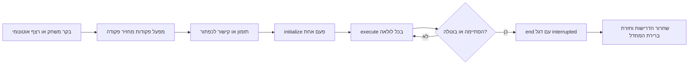

# 04 - פקודות, תתי־מערכות ותזמון

[English](../04-commands.md) | [תוכן המדריך](../../../README.he.md#learning-path) | דוגמה: [04 קבוצות פקודות](../../../TeamCode/src/main/java/org/firstinspires/ftc/teamcode/examples/Example04CommandGroups.java) | הבא: [חומרה](05-hardware.md)

## מה רץ בכל לולאה

מתזמן הפקודות מתאם פעולות ללא סקריפט חוסם. `super.run()` מטפל בתתי־מערכות רשומות, בכפתורים ובפקודות מתוזמנות. `periodic()` של תת־מערכת נקרא אוטומטית; PedroDrive משתמש בו לעדכון המיקום ופלטי המנועים. פקודות ברירת מחדל מתוזמנות כשתת־מערכת פנויה, ולכן הביצוע הראשון שלהן עשוי להתחיל באיטרציה מאוחרת יותר. אין להסתמך על מספר לולאות מדויק לתזמון פיזי.

קריאה ל־`motor.run(() -> 0.2)` רק יוצרת פקודה ואינה מפעילה מנוע. יש לתזמן את התוצאה, לקשר אותה לכפתור או להציב אותה בקבוצה מתוזמנת. ברובוט שבארכיון הייתה לולאה שיצרה פקודת טעינה והשליכה אותה; לכן ההבחנה חשובה.

## מחזור חיים וניקוי

| פעולה | שימוש |
|---|---|
| `initialize()` | קביעת מצב פעם אחת בתחילת הפעולה |
| `execute()` | ביצוע או עדכון בכל מחזור מתזמן |
| `isFinished()` | קביעת מועד הסיום הרגיל |
| `end(interrupted)` | שחרור פלטים לאחר סיום או ביטול |

`InstantCommand` רצה פעם אחת ומסתיימת. `RunCommand` חוזרת על הפעולה ואינה מסתיימת מעצמה. `MotorCommands.run(action, stop, finished, requirements...)` יוצרת פקודה רציפה שבודקת תנאי סיום ומפעילה ניקוי בסיום. פקודת עצירה כברירת מחדל חייבת להמשיך לרוץ; פקודת עצירה מפורשת בתוך רצף חייבת להסתיים. ערבוב ביניהן עלול לתקוע רצף לעד.

ביטול מפעיל ניקוי; הוא אינו שקול לקריאה ל־`stopCommand()` של תת־מערכת אחרת. אין הבטחה שקוד המופיע אחרי פקודה שנקטעה בתוך `.andThen(...)` ירוץ. מקמו ניקוי מנוע חיוני ב־`end`, כמו ב־MotorCommands. RobotCommandOpMode מבטל פקודות לפני השלכת המתזמן, כך שהניקוי שלהן נשמר.

## דרישות ובעלות

העבירו את תת־המערכת כדרישה בכל פקודה ששולטת בה. המתזמן מונע משתי פקודות עצמאיות להחזיק אותה תת־מערכת בו־זמנית. תזמון פקודה מתחרה מבטל את הבעלים הנוכחי אם ניתן להפריע לו. קבוצה מחזיקה באיחוד דרישות ילדיה, לעיתים לאורך כל חייה.

שיעור המנוע מקשר A ו־B לפקודות מנוגדות באותה תת־מערכת. אלה פעולות מתחרות, ולא שני הספקים עצמאיים שאפשר לחבר. הימנעו מהחזקת שניהם. ילדים מקביליים אינם רשאים לדרוש אותה תת־מערכת; סדרו פעולות של מנגנון משותף ברצף.

FollowPathCommand של Pedro מכירה את העוקב שלה, אך אינה מכירה את מעטפת PedroDrive שלנו. Example06 מוסיפה במפורש את `drive` כדרישה לרצף ההורה. פעלו כך בשילוב פקודות מסלול ופקודת נהיגה כברירת מחדל. פעולת מנגנון באותה שגרה צריכה להיות ילד בקבוצה, ולא פקודה שמתוזמנת בנפרד מתוך callback וגוזלת את דרישות ההורה.

## כפתורים וספקי ערכים

- `whenPressed(command)` מתחילה ברגע הלחיצה; שחרור אינו בהכרח מבטל אותה.
- `whileHeld(command)` רצה בזמן החזקה ומתבטלת בשחרור. היא עשויה לתזמן מחדש פקודה שכבר הסתיימה כל עוד הכפתור מוחזק; הביאו זאת בחשבון בטיפול בתקלות.
- `toggleWhenPressed(command)` מפעילה ומכבה פקודה רציפה לסירוגין.
- קישורי Runnable נוחים לשינויים מיידיים, כמו היפוך ערך בוליאני.

צרו פקודה חדשה ממפעל לכל הרכב נפרד של קבוצה או קישור. אל תכניסו אותו מופע פקודה למספר קבוצות. ערכים שנלכדו כטיפוסים פרימיטיביים הם תמונת מצב; ספקים יכולים לקרוא ערכים חיים. בדקו במפעל המסוים אם ההערכה מתבצעת פעם אחת או בכל לולאה.

## קבוצות וזמן

| הרכב | מתי מסתיים | דוגמה מתאימה |
|---|---|---|
| `SequentialCommandGroup` | כל ילד מסתיים לפי הסדר | הזזת סרוו, המתנה, הפעלת מנוע |
| `ParallelCommandGroup` | כל הילדים מסתיימים | פעולות עצמאיות וסופיות |
| `ParallelDeadlineGroup` | הילד הראשון המוגדר מסתיים | מנוע עד סיום טיימר או מסלול |
| `.withTimeout(750)` | הפקודה מסתיימת או חולפות 750 מילישניות | הגבלת פעולת מנוע בחוג פתוח |
| `WaitCommand(250)` | חולפות 250 מילישניות | השהיה שאינה חוסמת בין פעולות |

הזמנים בספרייה כאן הם **מילישניות**. סיום בקשת סרוו אומר שהבקשה נשלחה; המתנה שנבחרה היא רק אומדן זמן התנועה. סיום מסלול עקב timeout מעיד שחלף זמן, ולא שהיעד הושג. הוסיפו טלמטריה מפורשת או החלטת תקלה אם ניקוד בהמשך תלוי בהגעה.

הימנעו מ־`sleep()` או מ־`while` ממושך בתוך `execute()` או `run()`: הם מונעים עדכוני מתזמן, מיקום, כפתורים וטלמטריה. ייצגו המתנה באמצעות פקודה או תנאי הנבדק בכל מחזור.

תרגיל: קצרו את משך הילד הקובע את הסיום ב־Example04, ודאו שפעולת הסרוו והניקוי עדיין מתבצעים, ואז בטלו באמצע באמצעות B. הוסיפו תת־מערכת שנייה ושונה במקביל. הסבירו איזו קבוצה מחזיקה בכל תת־מערכת לפני ההרצה.

